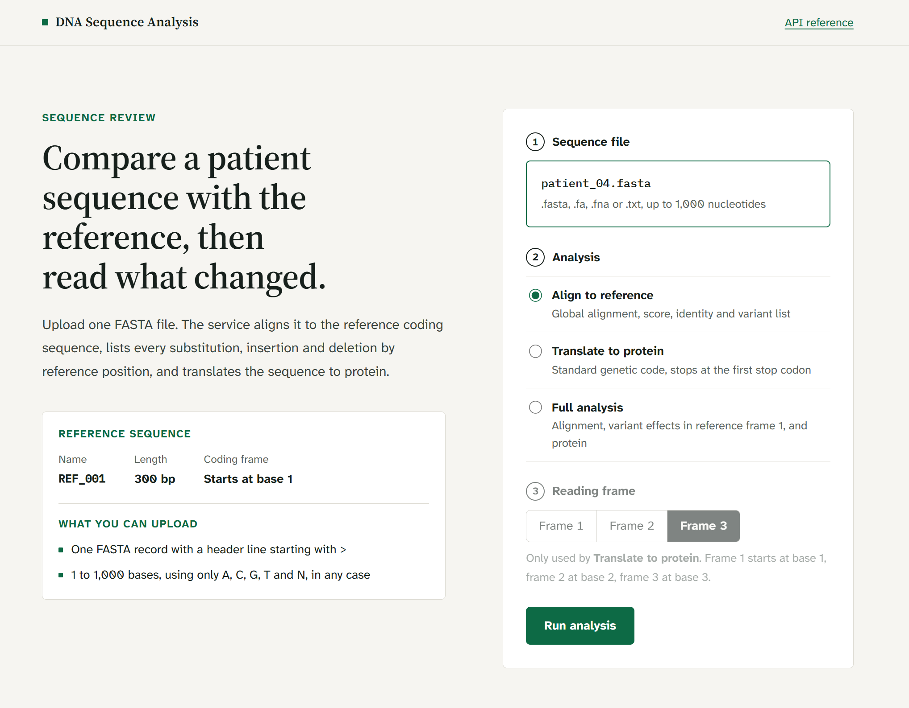
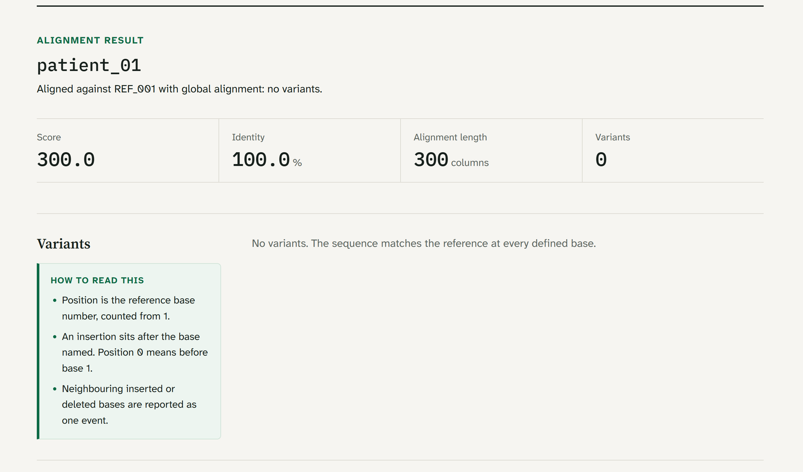
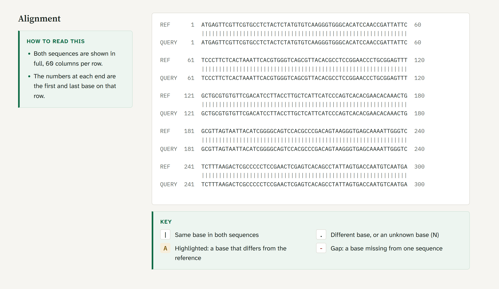

# DNA Sequence Analysis API

A small REST API built with FastAPI for two tasks on DNA sequences:

1. `POST /api/align`: global alignment of a query against the reference `REF_001`, with variant detection.
2. `POST /api/translate`: translation of the query into protein in reading frame 1, 2 or 3.

## Project structure

```
app/
  main.py          app setup, error handlers, web page
  errors.py        input error classes
  routers/         HTTP layer: reads the request, calls services
  services/        all logic: FASTA, alignment, variants, translation, effects
  schemas/         Pydantic response models
  data/            reference.fasta (REF_001)
web/               plain HTML/CSS/JS interface
tests/             pytest suite and the five patient FASTA files
```

## Installation

Requires Python 3.11 or newer (developed on 3.14).

```bash
git clone https://github.com/jamestiono19/dna-analysis-api.git
cd dna-analysis-api
python -m venv .venv
# Windows:      .venv\Scripts\activate
# macOS/Linux:  source .venv/bin/activate
pip install -r requirements.txt
```

## Running the API

```bash
uvicorn app.main:app --port 8000
```
- API docs: http://localhost:8000/docs
- Web interface: http://localhost:8000/

### With Docker

```bash
docker build -t dna-analysis-api .
docker run -p 8000:8000 dna-analysis-api
```

## Requests Protocol

Run these from the repository root.

```bash
curl.exe -X POST http://localhost:8000/api/align -F "file=@tests/fixtures/patient_02.fasta"

curl.exe -X POST http://localhost:8000/api/translate -F "file=@tests/fixtures/patient_02.fasta" -F "frame=1"

curl.exe -X POST http://localhost:8000/api/analyze -F "file=@tests/fixtures/patient_02.fasta"
```

Example response for `patient_02` (the API returns both aligned strings in full):

```json
{
  "sequence_id": "patient_02",
  "reference_id": "REF_001",
  "alignment": {"score": 294.0, "identity": 0.99, "reference_aligned": "ATGAGTTCG...", "query_aligned": "ATGAGTTCG..."},
  "variants": [
    {"position": 52, "ref": "C", "alt": "A", "type": "SNV"},
    {"position": 177, "ref": "A", "alt": "T", "type": "SNV"},
    {"position": 245, "ref": "T", "alt": "G", "type": "SNV"}
  ]
}
```

## Running the tests

```bash
pytest -v
```

## Test results

Run on Windows (win32) with Python 3.14.3 and pytest 9.2.0, from the project root:

```powershell
python -m pytest -v
```

Result: **153 passed, 1 warning** in 4.29 s. The warning comes from FastAPI's test client importing `httpx` through Starlette, and it does not affect any test.

<details>
<summary>Full <code>pytest -v</code> output</summary>

```text
============================= test session starts =============================
platform win32 -- Python 3.14.3, pytest-9.2.0, pluggy-1.7.0 -- C:\Users\HP\James T\Internship\TechnicalTest_BioinformaticsEngineer_Intern\dna-analysis-api\.venv\Scripts\python.exe
cachedir: .pytest_cache
rootdir: C:\Users\HP\James T\Internship\TechnicalTest_BioinformaticsEngineer_Intern\dna-analysis-api
configfile: pytest.ini
testpaths: tests
plugins: anyio-4.16.0
collected 153 items

tests/test_alignment.py::test_identical_sequences PASSED                 [  0%]
tests/test_alignment.py::test_mismatch_scores_minus_one PASSED           [  1%]
tests/test_alignment.py::test_each_gap_character_scores_minus_two PASSED [  1%]
tests/test_alignment.py::test_n_scores_zero PASSED                       [  2%]
tests/test_alignment.py::test_n_against_n_is_not_counted_as_identical PASSED [  3%]
tests/test_alignment.py::test_identity_counts_gap_columns PASSED         [  3%]
tests/test_alignment.py::test_tie_break_keeps_a_deletion_in_one_piece PASSED [  4%]
tests/test_alignment.py::test_tie_break_is_deterministic PASSED          [  5%]
tests/test_alignment.py::test_aligned_strings_contain_the_complete_inputs[patient_01.fasta] PASSED [  5%]
tests/test_alignment.py::test_aligned_strings_contain_the_complete_inputs[patient_02.fasta] PASSED [  6%]
tests/test_alignment.py::test_aligned_strings_contain_the_complete_inputs[patient_03.fasta] PASSED [  7%]
tests/test_alignment.py::test_aligned_strings_contain_the_complete_inputs[patient_04.fasta] PASSED [  7%]
tests/test_alignment.py::test_aligned_strings_contain_the_complete_inputs[patient_05.fasta] PASSED [  8%]
tests/test_alignment.py::test_patient_01_is_identical_to_reference PASSED [  9%]
tests/test_alignment.py::test_patient_02_matches_the_example_in_the_brief PASSED [  9%]
tests/test_api_align.py::test_patient_02_matches_the_example_in_the_brief PASSED [ 10%]
tests/test_api_align.py::test_variant_coordinates_and_grouping_for_each_patient[patient_01.fasta] PASSED [ 11%]
tests/test_api_align.py::test_variant_coordinates_and_grouping_for_each_patient[patient_02.fasta] PASSED [ 11%]
tests/test_api_align.py::test_variant_coordinates_and_grouping_for_each_patient[patient_03.fasta] PASSED [ 12%]
tests/test_api_align.py::test_variant_coordinates_and_grouping_for_each_patient[patient_04.fasta] PASSED [ 13%]
tests/test_api_align.py::test_variant_coordinates_and_grouping_for_each_patient[patient_05.fasta] PASSED [ 13%]
tests/test_api_align.py::test_full_aligned_strings_are_returned[patient_01.fasta] PASSED [ 14%]
tests/test_api_align.py::test_full_aligned_strings_are_returned[patient_02.fasta] PASSED [ 15%]
tests/test_api_align.py::test_full_aligned_strings_are_returned[patient_03.fasta] PASSED [ 15%]
tests/test_api_align.py::test_full_aligned_strings_are_returned[patient_04.fasta] PASSED [ 16%]
tests/test_api_align.py::test_full_aligned_strings_are_returned[patient_05.fasta] PASSED [ 16%]
tests/test_api_align.py::test_patient_05_insertion_is_supported_by_returned_alignment PASSED [ 17%]
tests/test_api_align.py::test_lowercase_input_gives_the_same_result PASSED [ 18%]
tests/test_api_align.py::test_n_heavy_sequence_is_accepted PASSED        [ 18%]
tests/test_api_align.py::test_length_limit PASSED                        [ 19%]
tests/test_api_align.py::test_invalid_fasta_returns_400_json[>s\nACGU] PASSED [ 20%]
tests/test_api_align.py::test_invalid_fasta_returns_400_json[>a\nACGT\n>b\nACGT] PASSED [ 20%]
tests/test_api_align.py::test_invalid_fasta_returns_400_json[>s\n] PASSED [ 21%]
tests/test_api_align.py::test_invalid_fasta_returns_400_json[>\nACGT] PASSED [ 22%]
tests/test_api_align.py::test_invalid_fasta_returns_400_json[ACGT] PASSED [ 22%]
tests/test_api_align.py::test_invalid_fasta_returns_400_json[>s\nAC GT] PASSED [ 23%]
tests/test_api_align.py::test_invalid_fasta_returns_400_json[] PASSED    [ 24%]
tests/test_api_align.py::test_missing_file_returns_422_json PASSED       [ 24%]
tests/test_api_align.py::test_text_field_instead_of_file_returns_422_json PASSED [ 25%]
tests/test_api_analyze.py::test_patient_02_synonymous_missense_nonsense PASSED [ 26%]
tests/test_api_analyze.py::test_patient_03_deletions PASSED              [ 26%]
tests/test_api_analyze.py::test_patient_05_insertions PASSED             [ 27%]
tests/test_api_analyze.py::test_response_includes_frame_1_translation PASSED [ 28%]
tests/test_api_analyze.py::test_invalid_fasta_returns_400_json[>s\nACGX] PASSED [ 28%]
tests/test_api_analyze.py::test_invalid_fasta_returns_400_json[>a\nA\n>b\nA] PASSED [ 29%]
tests/test_api_translate.py::test_patient_02_matches_the_example_in_the_brief PASSED [ 30%]
tests/test_api_translate.py::test_frame_defaults_to_one PASSED           [ 30%]
tests/test_api_translate.py::test_every_patient_in_every_frame[1-patient_01.fasta] PASSED [ 31%]
tests/test_api_translate.py::test_every_patient_in_every_frame[1-patient_02.fasta] PASSED [ 32%]
tests/test_api_translate.py::test_every_patient_in_every_frame[1-patient_03.fasta] PASSED [ 32%]
tests/test_api_translate.py::test_every_patient_in_every_frame[1-patient_04.fasta] PASSED [ 33%]
tests/test_api_translate.py::test_every_patient_in_every_frame[1-patient_05.fasta] PASSED [ 33%]
tests/test_api_translate.py::test_every_patient_in_every_frame[2-patient_01.fasta] PASSED [ 34%]
tests/test_api_translate.py::test_every_patient_in_every_frame[2-patient_02.fasta] PASSED [ 35%]
tests/test_api_translate.py::test_every_patient_in_every_frame[2-patient_03.fasta] PASSED [ 35%]
tests/test_api_translate.py::test_every_patient_in_every_frame[2-patient_04.fasta] PASSED [ 36%]
tests/test_api_translate.py::test_every_patient_in_every_frame[2-patient_05.fasta] PASSED [ 37%]
tests/test_api_translate.py::test_every_patient_in_every_frame[3-patient_01.fasta] PASSED [ 37%]
tests/test_api_translate.py::test_every_patient_in_every_frame[3-patient_02.fasta] PASSED [ 38%]
tests/test_api_translate.py::test_every_patient_in_every_frame[3-patient_03.fasta] PASSED [ 39%]
tests/test_api_translate.py::test_every_patient_in_every_frame[3-patient_04.fasta] PASSED [ 39%]
tests/test_api_translate.py::test_every_patient_in_every_frame[3-patient_05.fasta] PASSED [ 40%]
tests/test_api_translate.py::test_each_reading_frame[1-NGL-False] PASSED [ 41%]
tests/test_api_translate.py::test_each_reading_frame[2-MA-True] PASSED   [ 41%]
tests/test_api_translate.py::test_each_reading_frame[3-WP-False] PASSED  [ 42%]
tests/test_api_translate.py::test_lowercase_input PASSED                 [ 43%]
tests/test_api_translate.py::test_n_containing_codons_become_x PASSED    [ 43%]
tests/test_api_translate.py::test_patient_04_n_blocks_become_x PASSED    [ 44%]
tests/test_api_translate.py::test_stop_handling PASSED                   [ 45%]
tests/test_api_translate.py::test_incomplete_final_codon PASSED          [ 45%]
tests/test_api_translate.py::test_no_complete_codon PASSED               [ 46%]
tests/test_api_translate.py::test_length_limit PASSED                    [ 47%]
tests/test_api_translate.py::test_empty_frame_field_uses_default PASSED  [ 47%]
tests/test_api_translate.py::test_invalid_frame_returns_422_json[0] PASSED [ 48%]
tests/test_api_translate.py::test_invalid_frame_returns_422_json[4] PASSED [ 49%]
tests/test_api_translate.py::test_invalid_frame_returns_422_json[-1] PASSED [ 49%]
tests/test_api_translate.py::test_invalid_frame_returns_422_json[1.5] PASSED [ 50%]
tests/test_api_translate.py::test_invalid_frame_returns_422_json[abc] PASSED [ 50%]
tests/test_api_translate.py::test_invalid_frame_returns_422_json[ ] PASSED [ 51%]
tests/test_api_translate.py::test_invalid_frame_returns_422_json[01] PASSED [ 52%]
tests/test_api_translate.py::test_invalid_fasta_returns_400_json[>s\nACGX] PASSED [ 52%]
tests/test_api_translate.py::test_invalid_fasta_returns_400_json[>a\nACG\n>b\nACG] PASSED [ 53%]
tests/test_api_translate.py::test_invalid_fasta_returns_400_json[>s\n] PASSED [ 54%]
tests/test_api_translate.py::test_missing_file_returns_422_json PASSED   [ 54%]
tests/test_effects.py::test_synonymous PASSED                            [ 55%]
tests/test_effects.py::test_missense PASSED                              [ 56%]
tests/test_effects.py::test_nonsense PASSED                              [ 56%]
tests/test_effects.py::test_two_snvs_in_one_codon_are_judged_together PASSED [ 57%]
tests/test_effects.py::test_n_in_the_same_codon_makes_snv_undetermined PASSED [ 58%]
tests/test_effects.py::test_frameshift_and_inframe_deletion PASSED       [ 58%]
tests/test_effects.py::test_frameshift_and_inframe_insertion PASSED      [ 59%]
tests/test_effects.py::test_snv_after_uncompensated_frameshift_is_undetermined PASSED [ 60%]
tests/test_fasta.py::test_single_record PASSED                           [ 60%]
tests/test_fasta.py::test_sequence_id_is_first_token_of_header PASSED    [ 61%]
tests/test_fasta.py::test_multiline_blank_lines_crlf_and_surrounding_whitespace PASSED [ 62%]
tests/test_fasta.py::test_lowercase_is_converted_to_uppercase PASSED     [ 62%]
tests/test_fasta.py::test_sequence_of_only_n_is_accepted PASSED          [ 63%]
tests/test_fasta.py::test_length_limit_boundary_is_accepted PASSED       [ 64%]
tests/test_fasta.py::test_length_limit_counts_bases_across_lines PASSED  [ 64%]
tests/test_fasta.py::test_invalid_fasta_is_rejected[-no header line] PASSED [ 65%]
tests/test_fasta.py::test_invalid_fasta_is_rejected[\n\n-no header line] PASSED [ 66%]
tests/test_fasta.py::test_invalid_fasta_is_rejected[ACGT\n-must start with a header] PASSED [ 66%]
tests/test_fasta.py::test_invalid_fasta_is_rejected[>\nACGT-header is empty] PASSED [ 67%]
tests/test_fasta.py::test_invalid_fasta_is_rejected[>   \nACGT-header is empty] PASSED [ 67%]
tests/test_fasta.py::test_invalid_fasta_is_rejected[>s\n-no sequence] PASSED [ 68%]
tests/test_fasta.py::test_invalid_fasta_is_rejected[>s\n\n\n-no sequence] PASSED [ 69%]
tests/test_fasta.py::test_invalid_fasta_is_rejected[>s\nAC GT-whitespace inside the sequence] PASSED [ 69%]
tests/test_fasta.py::test_invalid_fasta_is_rejected[>s\nAC\tGT-whitespace inside the sequence] PASSED [ 70%]
tests/test_fasta.py::test_invalid_fasta_is_rejected[>s\nACGU-Invalid character 'U'] PASSED [ 71%]
tests/test_fasta.py::test_invalid_fasta_is_rejected[>s\nACG-T-Invalid character '-'] PASSED [ 71%]
tests/test_fasta.py::test_invalid_fasta_is_rejected[>s\nACGT*-Invalid character '*'] PASSED [ 72%]
tests/test_fasta.py::test_invalid_fasta_is_rejected[>a\nACGT\n>b\nACGT-Only one FASTA record] PASSED [ 73%]
tests/test_fasta.py::test_invalid_fasta_is_rejected[>a\nACGT\n>-Only one FASTA record] PASSED [ 73%]
tests/test_fasta.py::test_invalid_fasta_is_rejected[text14-The limit is 1000] PASSED [ 74%]
tests/test_fasta.py::test_invalid_character_position_is_reported PASSED  [ 75%]
tests/test_fasta.py::test_decode_removes_byte_order_mark PASSED          [ 75%]
tests/test_fasta.py::test_decode_rejects_binary_content PASSED           [ 76%]
tests/test_smoke.py::test_app_starts PASSED                              [ 77%]
tests/test_translation.py::test_codon_table_is_the_standard_code PASSED  [ 77%]
tests/test_translation.py::test_each_reading_frame[1-NGL-False] PASSED   [ 78%]
tests/test_translation.py::test_each_reading_frame[2-MA-True] PASSED     [ 79%]
tests/test_translation.py::test_each_reading_frame[3-WP-False] PASSED    [ 79%]
tests/test_translation.py::test_default_frame_is_one PASSED              [ 80%]
tests/test_translation.py::test_codon_with_n_becomes_x PASSED            [ 81%]
tests/test_translation.py::test_translation_stops_before_first_stop_codon[TAA] PASSED [ 81%]
tests/test_translation.py::test_translation_stops_before_first_stop_codon[TAG] PASSED [ 82%]
tests/test_translation.py::test_translation_stops_before_first_stop_codon[TGA] PASSED [ 83%]
tests/test_translation.py::test_stop_like_codon_with_n_is_not_a_stop PASSED [ 83%]
tests/test_translation.py::test_no_stop_codon PASSED                     [ 84%]
tests/test_translation.py::test_incomplete_final_codon_is_ignored[ATGGC-M] PASSED [ 84%]
tests/test_translation.py::test_incomplete_final_codon_is_ignored[ATGGCCA-MA] PASSED [ 85%]
tests/test_translation.py::test_no_complete_codon_gives_empty_result[A-1] PASSED [ 86%]
tests/test_translation.py::test_no_complete_codon_gives_empty_result[AC-1] PASSED [ 86%]
tests/test_translation.py::test_no_complete_codon_gives_empty_result[ACG-2] PASSED [ 87%]
tests/test_translation.py::test_no_complete_codon_gives_empty_result[ACGT-3] PASSED [ 88%]
tests/test_translation.py::test_stop_as_first_codon_gives_empty_protein_with_stop PASSED [ 88%]
tests/test_translation.py::test_invalid_frame_is_rejected[0] PASSED      [ 89%]
tests/test_translation.py::test_invalid_frame_is_rejected[4] PASSED      [ 90%]
tests/test_translation.py::test_invalid_frame_is_rejected[-1] PASSED     [ 90%]
tests/test_translation.py::test_patient_02_matches_the_example_in_the_brief PASSED [ 91%]
tests/test_variants.py::test_no_variants_returns_empty_list PASSED       [ 92%]
tests/test_variants.py::test_snv_uses_one_based_reference_position PASSED [ 92%]
tests/test_variants.py::test_n_is_never_an_snv PASSED                    [ 93%]
tests/test_variants.py::test_consecutive_deleted_bases_are_one_event PASSED [ 94%]
tests/test_variants.py::test_deletion_at_start PASSED                    [ 94%]
tests/test_variants.py::test_deletion_at_end PASSED                      [ 95%]
tests/test_variants.py::test_separate_deletions_are_not_merged PASSED    [ 96%]
tests/test_variants.py::test_consecutive_inserted_bases_are_one_event PASSED [ 96%]
tests/test_variants.py::test_insertion_before_first_base_is_position_zero PASSED [ 97%]
tests/test_variants.py::test_insertion_after_last_base PASSED            [ 98%]
tests/test_variants.py::test_deletion_shifts_later_coordinates PASSED    [ 98%]
tests/test_variants.py::test_insertion_does_not_shift_later_coordinates PASSED [ 99%]
tests/test_variants.py::test_mixed_events_are_sorted_by_position PASSED  [100%]

============================== warnings summary ===============================
.venv\Lib\site-packages\fastapi\testclient.py:1
  C:\Users\HP\James T\Internship\TechnicalTest_BioinformaticsEngineer_Intern\dna-analysis-api\.venv\Lib\site-packages\fastapi\testclient.py:1: StarletteDeprecationWarning: Using `httpx` with `starlette.testclient` is deprecated; install `httpx2` instead.
    from starlette.testclient import TestClient as TestClient  # noqa

-- Docs: https://docs.pytest.org/en/stable/how-to/capture-warnings.html
======================= 153 passed, 1 warning in 4.29s ========================
```

</details>


## Conventions

### Alignment scoring

Global alignment (Needleman-Wunsch), implemented without bioinformatics libraries.

| Case | Score |
|---|---|
| Match (same A/C/G/T base) | +1 |
| Mismatch (different A/C/G/T bases) | -1 |
| Gap (per gap character, linear) | -2 |
| Any column with N (N vs base, or N vs N) | 0 |

N is an unknown base, so it is neither rewarded nor penalised.

### Tie-breaking

Several alignments can share the best score. The aligner keeps three score tables (the last column is a
match/mismatch, a deletion or an insertion). Every gap character still costs -2, so the score is the same as
plain Needleman-Wunsch. The tables only decide ties:

- Inside a gap, extending the same gap is preferred, so a tied insert-delete stays as one grouped event.
- Otherwise the order is: match/mismatch, then deletion, then insertion.

Traceback runs from the end of the sequences, so a tied indel is placed as far to the left as possible.
For example, `ACGTTGCA` against `ACGTGCA` gives `ACG-TGCA`. The same input always gives the same alignment.

### Identity

identity = identical A/C/G/T columns / all alignment columns (gaps and N columns included).
N/N does not count as a match. The value is between 0 and 1.

### Variants

- Types: `SNV`, `insertion`, `deletion`. No variants gives `[]`.
- SNV and deletion positions are 1-based reference coordinates.
- Deletion: position is the first deleted base, `ref` is the deleted bases, `alt` is `-`.
- Insertion: position is the reference base before the insertion (0 means before base 1), `ref` is `-`, `alt` is the inserted bases.
- Consecutive inserted or deleted bases are grouped into one event, and events are sorted by position.
- An SNV is only called between two different A/C/G/T bases. A column with N is never an SNV.

### Translation

- Standard genetic code. Frame 1 starts at nucleotide 1, frame 2 at 2, frame 3 at 3.
- The given strand is translated directly: no start codon search, no reverse complement.
- Only complete codons are translated; 1 or 2 trailing nucleotides are ignored.
- Any codon containing N becomes `X`.
- Translation stops before the first TAA, TAG or TGA, and `*` is never returned.
  A codon such as `TAN` is `X`, not a stop.
- `has_stop_codon` is true only if a stop was reached. `length` is `len(protein)`, including X.
- If the frame leaves no complete codon, the result is `""`, length 0, `has_stop_codon` false.

### Errors

Every error returns JSON in the same shape:

```json
{"error": {"type": "invalid_fasta", "message": "Invalid character 'U' at sequence position 4. Only A, C, G, T and N are allowed."}}
```

| Status | `type` | When |
|---|---|---|
| 400 | `invalid_fasta` | The file is not one valid FASTA record |
| 422 | `missing_file` | No file in the `file` field |
| 422 | `invalid_frame` | `frame` is not 1, 2 or 3 |
| 422 | `invalid_request` | Any other invalid request field |

## Variant effects

Returns the alignment, the variants with an `effect` field, and the frame-1 translation of the query.
Effects are judged against reference frame 1.

| Variant | Effect |
|---|---|
| SNV, same amino acid | `synonymous` |
| SNV, new stop codon | `nonsense` |
| SNV, different amino acid | `missense` |
| Insertion or deletion, length not a multiple of 3 | `frameshift` |
| Insertion or deletion, length a multiple of 3 | `in-frame insertion` / `in-frame deletion` |

How unclear cases are handled:

- **Several SNVs in one codon** are applied together. Each of them gets the effect of the combined codon.
- **Ambiguous codons**: if the query codon has an N or a gap, the SNV is `undetermined`.
- **After a frameshift**: an SNV after an insert-delete that has not been compensated (net shift not a multiple of 3)
  is `undetermined`, because the reference frame no longer applies.
- **Stop loss**: a stop codon changed into an amino acid is reported as `missense`, since the list has
  no stop-loss type. The `ref_amino_acid` (`*`) and `alt_amino_acid` fields show what happened.
- Insert-deletions are classified by length only. Their effect on nearby codons is not modelled.

## Assumptions

- The query is the forward strand of the same fragment as `REF_001`, and the reference frame starts at base 1.
- The reference is loaded by the server from `app/data/reference.fasta` and is not sent in the request.
- A missing `frame` field, or an empty one, means frame 1. FastAPI treats an empty form value as not sent.
- Status 400 is used for a bad file and 422 for a bad request.

## Web interface


